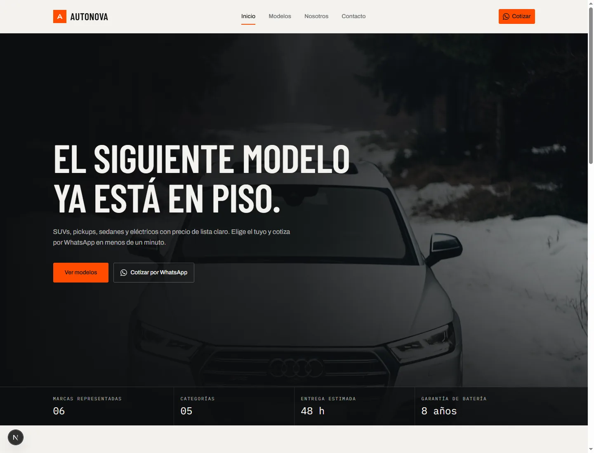

# AutoNova

Catálogo automotriz front-end con Next.js 15: modelos, fichas técnicas, cotización por WhatsApp y panel de administración con datos locales.

**Implementación de portafolio, no un producto listo para producción.** No tiene backend, pagos, inventario real ni autenticación de servidor.



**Sitio publicado:** <https://autonova-orcin.vercel.app/>

## Qué es

AutoNova cubre el flujo completo de un catálogo de agencia:

- Home con hero, destacados y categorías.
- Catálogo con filtros por categoría.
- Detalle con galería, ficha técnica, variantes y colores.
- Cotización por WhatsApp con modelo, variante y color en el mensaje.
- Panel de administración con login local, dashboard y CRUD de vehículos.

No hay carrito ni checkout: la conversión termina en una conversación por WhatsApp.

## Por qué este proyecto

- **Cotización, no checkout.** El CTA abre WhatsApp con el modelo y la configuración elegida. No hay carrito que abandonar.
- **Panel completo sin backend.** Login local, dashboard, CRUD, persistencia y restauración del catálogo en `localStorage`.
- **Imágenes locales con variantes responsive.** Fotos en `400/800/1200/1600` y `srcset`; sin requests a un CDN en runtime.
- **Stack mínimo.** Next.js 15, TypeScript estricto, Tailwind y primitivas de shadcn/ui. Sin Supabase ni Server Actions.
- **Qué no es.** No procesa pagos, no guarda datos en un servidor, no tiene email, inventario real ni autenticación de servidor. Si necesitas una tienda con checkout o un admin multiusuario, este proyecto no es la base.

## Empezar

Requisitos: Node.js 24 (ver `.nvmrc`) y pnpm 11. El proyecto declara Node >=20 en `package.json`; la verificación se hizo con Node 24.3 y pnpm 11.17.

```bash
git clone https://github.com/JORDANROBERTO74/autonova.git
cd autonova
pnpm install
pnpm dev
```

Abre <http://localhost:3000>. Las variables de entorno son opcionales para desarrollo: los valores por defecto permiten levantar el catálogo y el panel.

| Comando | Qué hace |
| --- | --- |
| `pnpm dev` | Servidor de desarrollo en el puerto 3000 |
| `pnpm build` | Build de producción + typecheck |
| `pnpm start` | Sirve el build de producción |
| `pnpm lint` | ESLint |
| `pnpm test` | Tests con Vitest |

## Rutas

| Ruta | Descripción |
| --- | --- |
| `/` | Home con hero, destacados y categorías |
| `/models` | Catálogo con filtros por categoría |
| `/models/[slug]` | Galería, ficha técnica, variantes y colores |
| `/nosotros` | Página de agencia |
| `/contacto` | Showroom y contacto |
| `/admin` | Entrada del panel; redirige a login o dashboard |
| `/admin/login` | Acceso con las credenciales configuradas |
| `/admin/dashboard` | Resumen del catálogo |
| `/admin/vehicles` | CRUD de vehículos |
| `/admin/vehicles/new` | Crear modelo |
| `/admin/vehicles/[id]/edit` | Editar modelo |

## Panel de administración

- `/admin` es la única entrada. No hay enlaces al panel en el sitio público.
- La sesión vive en `localStorage` (`autonova.admin.session.v1`) y expira a las 8 horas.
- Credenciales por defecto: `admin@autonova.mx` / `autonova2026`; se cambian en `.env.local`.
- El dashboard muestra total de modelos, categorías, precio promedio y valor del inventario.
- El CRUD permite crear, editar, eliminar y restaurar el catálogo.

**Importante:** las credenciales usan `NEXT_PUBLIC_*` y la sesión se guarda en `localStorage`. Es un control de acceso de interfaz, no autenticación real: las credenciales son visibles en el bundle y la sesión puede crearse manualmente. Para producción hace falta auth de servidor con cookie `httpOnly`.

## Variables de entorno

Copia [.env.example](.env.example) a `.env.local` si quieres cambiar los valores por defecto:

| Variable | Uso |
| --- | --- |
| `NEXT_PUBLIC_WHATSAPP_NUMBER` | Número de WhatsApp, solo dígitos. Por defecto `5215500000000`; cámbialo antes de publicar. |
| `NEXT_PUBLIC_SITE_URL` | Origen público para metadatos. Por defecto `http://localhost:3000`. |
| `NEXT_PUBLIC_ADMIN_EMAIL` | Correo del panel. Por defecto `admin@autonova.mx`. |
| `NEXT_PUBLIC_ADMIN_PASSWORD` | Password del panel. Por defecto `autonova2026`. |

## Arquitectura

```text
src/
  app/(site)/              home, catálogo, detalle, nosotros y contacto
  app/admin/               login, dashboard y CRUD
  components/              site, vehicles, admin y primitivas ui
  lib/                     datos, auth local, WhatsApp y utilidades
  lib/mock/vehicles.ts     seed de 8 vehículos
public/vehicles/           fotos y variantes responsive
docs/screenshot.webp       captura usada en este README
```

- `src/components/vehicles/vehicles-provider.tsx`: estado del catálogo en cliente; hidrata y persiste en `autonova.vehicles.v1`.
- `src/lib/admin-auth.ts`: sesión local de 8 horas.
- `src/lib/vehicles.ts`: tipos, schema Zod, especificaciones y conteos.
- `src/lib/whatsapp.ts`: único constructor de enlaces `wa.me` y mensajes de cotización.
- `src/components/admin/vehicle-form.tsx`: alta y edición validadas con Zod.

## Estado y alcance

- Implementación de portafolio, funcional en front-end; no lista para producción.
- Datos y precios ficticios.
- Sin backend, pagos, email, inventario real ni uploads: las imágenes se agregan por URL.
- El panel es local por navegador; no hay cuentas multiusuario ni datos compartidos.

## Verificación

- `pnpm lint` ✅
- `pnpm test` ✅ (13 tests)
- `pnpm build` ✅
- Instalación limpia desde el clon: `pnpm install --frozen-lockfile` + `pnpm build` ✅
- Probado en Node 24.3 y pnpm 11.17.

## Licencia

MIT para el código. Las fotos de `public/vehicles` son de Unsplash y mantienen su propia licencia. Ver [LICENSE](LICENSE).
